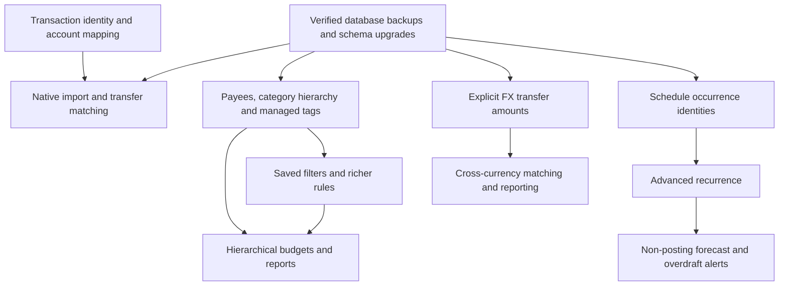

# HomeBank 5.10.3 → Ledgerra capability audit

Audit date: 2026-11-07. Ledgerra baseline: `5e11f7d` (released as v0.13.0).
Reference: the source archive supplied by the user, inspected without running its
installer or build scripts. Archive SHA-256:
`9597b4f30ffa71fefe49613fabbd1513725ab21185ff327716cef6274999227d`.

The supplied source is HomeBank 5.10.3, not a Windows installer. Its `doc/` directory
contains the manual corresponding to the blocked online help URL. The audit
compares documented workflows, fields, preferences, and active C data structures
against Ledgerra's domain models, API routes, UI, and regression tests. Commented-out
HomeBank enum values are not treated as implemented capabilities.

## Deliverables and confidence

- [Capability inventory](homebank-5.10.3-gap-inventory.csv): normalized functional gaps,
  baseline status, priority, HomeBank evidence, and Ledgerra evidence.
- [Source controls](homebank-5.10.3-source-controls.csv): every extracted section and
  table field from the supplied HTML manual, with source line numbers. This index
  preserves the small UI controls rather than hiding them inside broad feature labels.

`Present` means a comparable core workflow exists, not that every edge case has
been proven equivalent. `Partial` identifies concrete limitations. `Missing` means
no equivalent was found in the reviewed Ledgerra implementation; it is not inferred
just from a missing button label. `Different` identifies a product decision, not a
mandatory defect. `Current phase` is unreleased work and is excluded from baseline
parity claims. This is a source/documentation audit, not an exhaustive interactive
certification of both applications or a promise that every undocumented behavior
has been found. Desktop-specific theming/file menus need web equivalents where useful.

The inventory contains **378 capabilities** and the source index contains **813 controls/sections**.

| Baseline status | Count |
|---|---:|
| Present | 115 |
| Partial | 33 |
| Missing | 212 |
| Different | 6 |
| Current phase | 12 |

## Reference features versus recommendations

The inventory's `origin` column separates documented HomeBank behavior from
Ledgerra extensions, web/server adaptations, and engineering recommendations.
For example, a verified restore rehearsal and an import audit trail are sensible
Ledgerra improvements, not claims about built-in HomeBank features. The loan guide
explicitly documents a manual workflow and disclaims a built-in loan-input feature.
Desktop splash/icon/folder preferences are product adaptations rather than web defects.

- [Data-model index](homebank-5.10.3-data-model-index.csv): active source structure
  field identifiers and selected flag names, with source line numbers (no C implementation is copied). Flags marked for verification
  are evidence to inspect, not independent claims that a user feature exists.

## Important findings

1. The v0.13 bookkeeping upgrade supplies useful foundations, not full HomeBank parity.
2. Ledgerra has split storage and validation, but its main transaction form lacks a
   complete split-line editor. A backend model alone is not a finished user feature.
3. Payees and tags are only partly integrated: payees have limited management and
   defaults; tags are a free-text field rather than managed entities.
4. The Categories screen's merge suggestions do not perform a backend merge. Local
   display groups do not substitute for a persisted category hierarchy.
5. Existing filter URLs and one remembered view are not multiple named saved filters.
6. The scheduler currently supports weekly/monthly postings, not HomeBank's daily,
   yearly, every-N, nth-weekday, weekend, finite-count, and advance-posting controls.
7. Reconciliation is stricter than some HomeBank preferences: Ledgerra locks completed
   statements and requires reopening. This is an intentional safety rule to preserve.
8. Reports need a common filter/interval engine and non-posting schedule projections
   before credible forecasting and overdraft alerts can be added.
9. A mortgage account type alone is not amortization accounting. HomeBank's loan guide
   itself describes a workflow using accounts/categories; do not claim an automatic
   amortization engine exists without implementing and validating one in Ledgerra.
10. HomeBank's archived documentation is authoritative for that version; online-only
    changes after 5.10.3 are outside this audit.

## Current phase delivery and remaining limits

The v0.14.0 release candidate adds native transaction inspect/preview for
OFX/QFX, QIF and HomeBank, stable OFX FITID identities, owned-account/currency mapping,
and existing-entry transfer candidate scanning. Conservative automatic linking runs
when new ordinary entries or imported batches supply a unique evidenced counterpart.
Suggestions handle ambiguous matches; matched-pair history supports safe undo.
Reconciled/split/foreign-user/currency-incompatible entries are excluded.

Native import is transaction migration, not full HomeBank wallet conversion. It does
not recreate schedules, budgets, source reconciliation history, split allocations,
void/reminder entries, or FX transfers. Unsupported records are flagged/excluded;
selected values are never silently rounded to fit Ledgerra's two-decimal storage.
The capability inventory retains its **released v0.13.0 baseline**; current-phase
rows must not be read as claims that these functions already exist in that release.

The audit also found that the v0.13 user-data reset omitted the newly added
bookkeeping tables. The v0.14.0 changes fix cleanup for profiles, payees, reconciliations,
metadata and matching history, with an ownership regression test. This is Ledgerra
hardening, not a HomeBank UI-parity item.

Validation in this environment: 166 backend tests (8 domain + 158 API), 134 frontend
tests, and a production frontend build passed. Native parser tests cover SGML/XML,
QIF multi-account/date ordering, GLib Julian dates, entity rejection, ownership,
currency and FITID persistence through edits/backups. PostgreSQL-backed browser
workflows cover import/reimport, transfer recognition/undo, and existing bookkeeping.
The supplied source's sample wallet was inspected as 8 accounts and 742 supported
transactions without committing it. Existing transaction counts survived schema
reinitialization. Existing package advisories/build-size warnings remain separate
from feature correctness and were not changed by this phase.

## Dependency map

## Implementation sequence

### Phase 2 — imports and transfer recognition (current)

- OFX/QFX, QIF, and HomeBank transaction readers without AI.
- Explicit mapping from each source account to an owned Ledgerra account.
- Stable source identities (including OFX FITID), reviewable category/payee/reference/tag data.
- Existing-transaction transfer scanning; exact opposite same-currency values and date tolerance.
- Automatically link only mutually unique matches with transfer evidence; review ambiguous
  same-amount cases instead of arbitrarily pairing them. Preserve both balances and dates.
- Exclude reconciled, already-linked, split, and foreign-user transactions; support undo.

### Phase 3 — complete the everyday ledger

- Full split editor, templates/clone/add-and-keep, payment methods, void/reminder states.
- Complete payee/category/tag CRUD, hierarchy and merge with dependency repair.
- Metadata in every entry path, retroactive rules, compound matching and change preview.
- Saved filters shared by transactions/reports and backed up per user.

### Phase 4 — scheduling and forecasting

- Occurrence identities before advanced recurrence, so retries/edits cannot duplicate postings.
- Daily/yearly/every-N/nth-weekday/weekend/end-count/advance modes.
- Non-posting schedule projections; today/cleared/future balances and overdraft/credit limits.

### Phase 5 — budgets, reports and FX

- Income/annual budgets, copy/fill/import/monitoring and hierarchical rollups.
- Shared interval/filter engine; payee/tag/account statistics and export/print.
- Explicit cross-currency transfer amounts/rates, then optional online rate providers.

### Phase 6 — specialist workflows and operations

- Reminders/receivables, loan principal/interest/fees and vehicle/fuel tracking.
- Automated PostgreSQL backups, retention, restore drills and import/restore audit trails.
- Complete translation, keyboard, accessibility, display and preference synchronization.

## Data and rollout requirements

Each phase needs additive/versioned schema updates, user ownership checks, backup
round trips, upgrade tests on existing PostgreSQL data, and complete browser workflows.
Do not reinterpret historical positive amounts automatically. Distinguish an explicit
source transfer from a guessed same-amount match. Never erase one imported side when
linking or undoing a transfer. Preserve source IDs, splits, categories, payees, tags,
cleared state and reconciled history, or flag unsupported data before commit.

HomeBank is GPL-2.0-or-later; Ledgerra is MIT. Use the archive as a behavioral/file-format
reference and implement features independently in Ledgerra's architecture. Do not
copy HomeBank C implementation into the MIT project without a separate licensing decision.

## Coverage by area

| Area | Present | Partial | Missing | Different | Current phase |
|---|---:|---:|---:|---:|---:|
| Accounts | 10 | 3 | 13 | 0 | 0 |
| Transactions and ledger | 12 | 5 | 20 | 0 | 0 |
| Transfers | 5 | 0 | 7 | 0 | 6 |
| Split transactions | 4 | 1 | 7 | 0 | 0 |
| Payees | 4 | 2 | 10 | 0 | 0 |
| Categories | 8 | 2 | 8 | 0 | 0 |
| Tags | 0 | 2 | 8 | 0 | 0 |
| Import and export | 11 | 0 | 20 | 0 | 6 |
| Automation rules | 7 | 2 | 11 | 0 | 0 |
| Scheduling and templates | 9 | 2 | 17 | 0 | 0 |
| Budgets | 6 | 2 | 11 | 0 | 0 |
| Filtering and saved views | 9 | 3 | 15 | 0 | 0 |
| Reports and forecasting | 9 | 4 | 20 | 0 | 0 |
| Currencies | 5 | 0 | 5 | 2 | 0 |
| Specialized finance | 1 | 3 | 10 | 0 | 0 |
| Backups and wallet files | 6 | 0 | 9 | 2 | 0 |
| Preferences and ergonomics | 9 | 2 | 21 | 2 | 0 |
